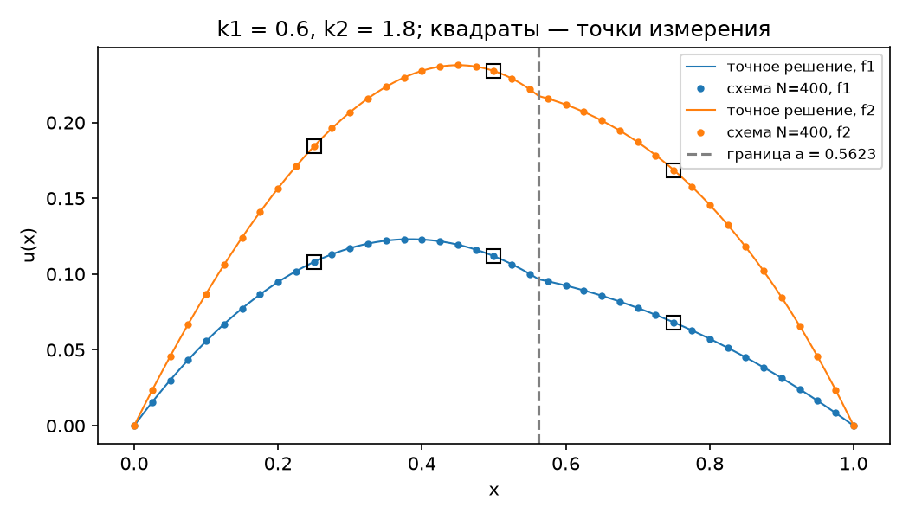
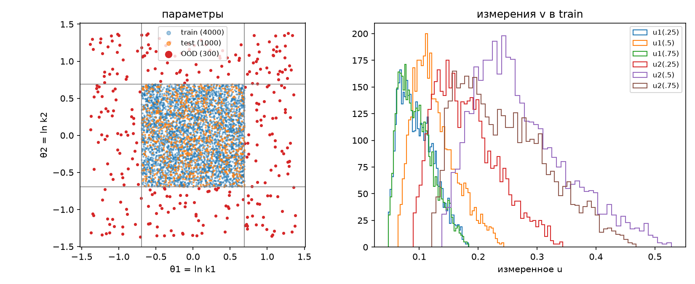
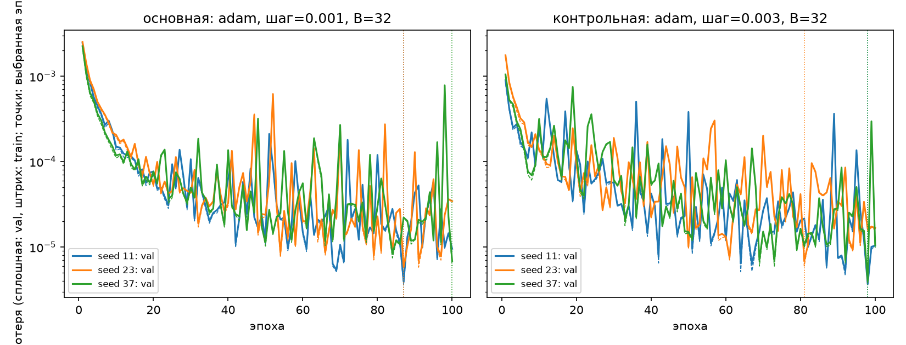
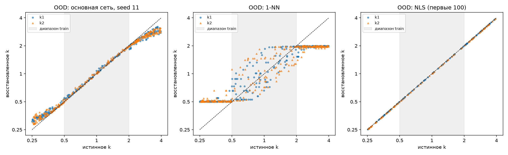
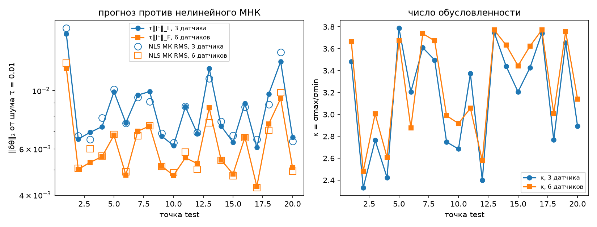
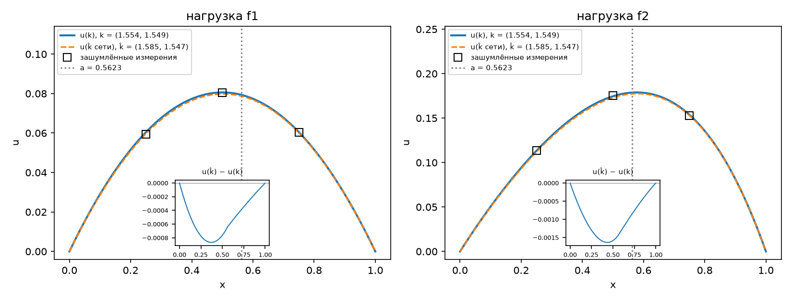

# Задание 03. Обратная задача: два материала

Восстановление коэффициентов теплопроводности (k₁, k₂) по шести измерениям температуры.
MLP 6 -> 64 -> 64 -> 2, прямой и обратный проходы и оптимизаторы написаны на NumPy без autograd.

Все числа и рисунки получены скриптами из `experiments/`,
Полный повторный прогон всех этапов даёт побитово те же веса сетей и те же таблицы
(отличаются только столбцы времени)

---

## 1. Постановка и вариант

**Вариант:** s = **2718**, граница материалов a = 0,3523 + 0,01·(2718 mod 31) = **0,5623**.

| что | значение |
|---|---|
| seed train / val / test / OOD / самопроверка | 2718 / 12718 / 22718 / 32718 / 42718 |
| seed сетей / шума | 11, 23, 37 / 101 |
| сетка train, val | N = 200 |
| сетка test, OOD, NLS, профили | N = 400 |

**Прямая задача:** −(k(x)u′)′ = fⱼ(x), u(0) = u(1) = 0, k = k₁ при x < a и k₂ при x ≥ a,
f₁ = 1, f₂ = 1 + 4x². На границе непрерывны u и поток k·u′.

**Вход сети** v ∈ ℝ⁶: u₁(0,25), u₁(0,5), u₁(0,75), u₂(0,25), u₂(0,5), u₂(0,75).
**Цель:** θ = (ln k₁, ln k₂), k̂ = exp θ̂.

---

## 2. Решатель и его проверка

**Схема** (`solver.py`). Консервативная схема на N интервалах, h = 1/N:

  −[k_{i+½}(u_{i+1} − u_i) − k_{i−½}(u_i − u_{i−1})]/h² = f(x_i),  i = 1…N−1.

На ребре, которое пересекает граница, берётся гармоническое среднее
k_{i+½} = h/(ℓ₁/k₁ + ℓ₂/k₂). Физически это последовательное соединение тепловых сопротивлений.
Граница не округляется до узла: a·N = 56,23 / 112,46 / 224,92 при N = 100 / 200 / 400.
Трёхдиагональная система решается `scipy.linalg.solve_banded`.

Для независимой проверки выведено **точное решение**: k·u′ = C − F(x), F = ∫₀ˣ f,
u(x) = ∫₀ˣ (C − F)/k, константа C находится из u(1) = 0.
Это кусочный многочлен, интегралы берутся явно.

**Проверка 1a** (k₁ = k₂ = k, f₁, точное решение x(1 − x)/(2k)): максимальная ошибка
от 4·10⁻¹⁶ до 1,1·10⁻¹⁴ при k ∈ {0,5; 1; 2} и N ∈ {100, 200, 400}. Остаётся только округление.

**Проверка 1b** (10 профилей с k₁ ≠ k₂, обе нагрузки). Разности измерений на соседних сетках -
от 10⁻⁷ до 10⁻⁵ при самих значениях u ~ 0,1. Медиана наблюдаемого порядка: 1,00 для f₁, 1,63 для f₂.
Сравнение с точным решением: относительная ошибка измерений при N = 400 не больше 2,3·10⁻⁶.

**Почему у f₁ «порядок» ровно 1,00.** Для f₁ = 1 схема точна на всех рёбрах, кроме ребра с границей.
Локальный дефект на нём равен (1/k₂ − 1/k₁)·h²·θ(1 − θ)/2, где θ - дробная часть a·N,
то есть положение границы внутри ребра. Ошибка поэтому пропорциональна h²·θ(1 − θ),
а не чистой степени h. При θ = 0,23 / 0,46 / 0,92:

| отношение | предсказание h²θ(1−θ) | наблюдение (медиана по 10 профилям) |
|---|---|---|
| e(100)/e(200) | 2,85 | 2,85 |
| e(200)/e(400) | 13,50 | 13,50 |
| (e₁₀₀ − e₂₀₀)/(e₂₀₀ − e₄₀₀) | 2,00 | 2,00 (столбец «отношение» проверки 1b) |



---

## 3. Данные

| набор | n | сетка | назначение |
|---|---|---|---|
| train | 4000 | 200 | обучение, нормировка |
| val | 1000 | 200 | выбор конфигурации и эпохи |
| test | 1000 | 400 | итоговая оценка |
| noisy test | 1000 | 400 | test + 0,01·d⊙ξ, ξ ~ N(0, I), seed 101 |
| OOD | 300 | 400 | ln k ~ U[ln 0,25; ln 4], хотя бы один k ∉ [0,5; 2] |
| test_N200 | 1000 | 200 | те же θ, что у test; только для анализа дискретизации |

- ln k₁, ln k₂ ~ U[ln 0,5; ln 2]. Нормировка z = (v − m)/d, где m и d - покомпонентные среднее и std **только по train**.
- В нормированных координатах шумовой тест - это ровно z + 0,01·ξ: проверено, std 0,01008.
- OOD получен отбраковкой по одной паре: принято 300, отброшена 91. Доля принятых 0,767 при теоретической 0,75.
- **Признаки сильно коррелированы** (от 0,72 до 0,999): шесть чисел управляются двумя параметрами.
- **OOD далеко за пределами обучения:** z до +9,7 против примерно ±2,5 у train, потому что малые k дают большие u.



---

## 4. Нейросеть на NumPy

**Архитектура:** 6 -> 64 -> 64 -> 2, tanh в скрытых слоях, линейный выход, **4738 параметров**.
Контрольная сеть 3 -> 64 -> 64 -> 2 - **4546 параметров**.
Инициализация LeCun W ~ N(0, 1/n_in), смещения нулевые.

**Прямой проход** (батч Z размера B×6):
H₁ = Z W₁ᵀ + b₁, A₁ = tanh H₁; H₂ = A₁W₂ᵀ + b₂, A₂ = tanh H₂; Θ̂ = A₂W₃ᵀ + b₃.

**Потеря:** L = (1/2B)·Σᵢ‖θ̂ᵢ − θᵢ‖², то есть MSE по θ.

**Обратный проход:**
```
G₃ = (Θ̂ − Θ)/B
dW₃ = G₃ᵀA₂,   db₃ = Σ G₃
G₂ = (G₃W₃) ⊙ (1 − A₂²)
dW₂ = G₂ᵀA₁,   db₂ = Σ G₂
G₁ = (G₂W₂) ⊙ (1 − A₁²)
dW₁ = G₁ᵀZ,    db₁ = Σ G₁
```

**Производная tanh:** tanh = sinh/cosh, поэтому
(tanh t)′ = (cosh² t − sinh² t)/cosh² t = 1/cosh² t = 1 − tanh² t.
Численная проверка даёт ~10⁻¹¹.

**Оптимизаторы** (`mlp.py`): SGD; Momentum p ← βp + g, θ ← θ − ηp, β = 0,9;
Adam с поправкой смещения, β₁ = 0,9, β₂ = 0,999, ε = 10⁻⁸.

**Работоспособность:** сеть запоминает 32 примера, потеря падает с 0,52 до 3·10⁻⁶ (Adam).
Дисперсия входов скрытых слоёв при инициализации 0,90 и 0,27, средняя tanh′ от 0,71 до 0,83: насыщения нет.

---

## 5. Проверка градиента (до обучения)

Сеть с seed = 11, начальные веса, мини-батч из первых 32 примеров train, float64, ε = 10⁻⁵.
Параметры выбраны генератором с seed s: 4 веса из каждой матрицы W₁, W₂, W₃, по одному смещению из b₁ и b₂, два из b₃.

| # | параметр | g (обратный проход) | b (центральная разность) |
|---|---|---|---|
| 1 | W1[16, 5] | +1,044865476388e−02 | +1,044865476363e−02 |
| 2 | W1[44, 3] | −2,807501250140e−02 | −2,807501249258e−02 |
| 3 | W1[0, 2] | +1,767719923477e−03 | +1,767719925994e−03 |
| 4 | W1[49, 5] | −1,129075624144e−04 | −1,129075610784e−04 |
| 5 | W2[8, 29] | −5,308451434698e−03 | −5,308451439534e−03 |
| 6 | W2[37, 33] | +9,716659104985e−02 | +9,716659105097e−02 |
| 7 | W2[9, 1] | −2,032482223991e−03 | −2,032482221415e−03 |
| 8 | W2[54, 41] | +1,048645198277e−02 | +1,048645197899e−02 |
| 9 | W3[0, 34] | −1,800634189312e−01 | −1,800634189253e−01 |
| 10 | W3[0, 25] | −5,201440677518e−01 | −5,201440677505e−01 |
| 11 | W3[0, 23] | +2,074688657529e−01 | +2,074688657483e−01 |
| 12 | W3[1, 31] | +4,387902324763e−02 | +4,387902325376e−02 |
| 13 | b1[56] | −4,248080606551e−04 | −4,248080609504e−04 |
| 14 | b2[23] | −2,058397885015e−05 | −2,058398451688e−05 |
| 15 | b3[1] | +1,386639020561e−01 | +1,386639020606e−01 |
| 16 | b3[0] | +1,841181215356e−01 | +1,841181215323e−01 |

‖g − b‖₂ / max(10⁻⁸, ‖g‖₂ + ‖b‖₂) = **1,3·10⁻¹¹** при допуске 10⁻⁴ - **пройдено**.

Контрольная сеть даёт 8,0·10⁻¹², проверка всех 4738 параметров основной сети - 3,1·10⁻¹¹

---

## 6. Обучение и выбор конфигурации по val

**Сетка** (seed 11, отдельно для каждой сети):
- оптимизатор ∈ {SGD, Momentum, Adam};
- 4 шага: SGD и Momentum {0,01; 0,03; 0,1; 0,3}, Adam {3·10⁻⁴; 10⁻³; 3·10⁻³; 10⁻²};
- батч ∈ {32, 128};
- не больше 100 эпох, сохраняются веса эпохи с минимальной val-потерей.

Test, шумовой test и OOD при выборе не использовались.

**Лучшее по каждому оптимизатору** (основная сеть, val):

| оптимизатор | шаг, батч | val-потеря | медиана e_k |
|---|---|---|---|
| SGD | 0,1; 32 | 7,4·10⁻⁵ | 0,55% |
| Momentum | 0,1; 32 | 6,9·10⁻⁶ | 0,15% |
| **Adam** | **10⁻³; 32** | **3,9·10⁻⁶** | **0,14%** |

SGD и Momentum с шагом 0,3 разошлись на первой эпохе.
**Выбрано:** основная сеть - Adam, шаг 10⁻³, батч 32; контрольная - Adam, шаг 3·10⁻³, батч 32.

**Финальные сети** (seed 11, 23, 37; среднее ± std):

| сеть | val RMSE θ | val медиана e_k |
|---|---|---|
| основная | 2,3·10⁻³ ± 3·10⁻⁴ | 0,15% ± 0,01% |
| контрольная | 2,2·10⁻³ ± 4·10⁻⁴ | 0,16% ± 0,04% |

Кривые train и val совпадают: переобучения нет, ошибку ограничивает оптимизация.
Adam с постоянным шагом колеблется около минимума; ранняя остановка по val выбирает лучшую эпоху.



---

## 7. Результаты сетей и базовых методов

**Метрики:**
- e_k = ‖k̂ − k‖₂/‖k‖₂ - медиана и 90-й процентиль;
- e_u - среднее по двум нагрузкам относительных L₂-ошибок полных профилей, пересчитанных при N = 400.

Срывы (nan, переполнение, абсурдное k̂, сбой решателя) входят в статистику как +∞.
**Срывов не было ни у одного метода ни на одном наборе.**

### 7.1. Полные наборы: сети и 1-NN

| набор | метод | медиана e_k | p90 e_k | медиана e_u | p90 e_u |
|---|---|---|---|---|---|
| clean (1000) | сеть основная | 1,42·10⁻³ ± 8·10⁻⁵ | 3,1·10⁻³ ± 5·10⁻⁴ | 9,0·10⁻⁴ ± 1·10⁻⁴ | 2,0·10⁻³ ± 1·10⁻⁴ |
| | сеть контроль | 1,54·10⁻³ ± 4·10⁻⁴ | 2,9·10⁻³ ± 9·10⁻⁴ | 9,8·10⁻⁴ ± 3·10⁻⁴ | 2,4·10⁻³ ± 5·10⁻⁴ |
| | 1-NN | 8,2·10⁻³ | 2,0·10⁻² | 3,9·10⁻³ | 7,5·10⁻³ |
| noisy (1000) | сеть основная | 6,4·10⁻³ ± 1·10⁻³ | 1,29·10⁻² ± 2·10⁻³ | 4,1·10⁻³ ± 7·10⁻⁴ | 9,3·10⁻³ ± 2·10⁻³ |
| | сеть контроль | 6,7·10⁻³ ± 8·10⁻⁴ | 1,37·10⁻² ± 1·10⁻³ | 4,3·10⁻³ ± 7·10⁻⁴ | 9,4·10⁻³ ± 2·10⁻³ |
| | 1-NN | 8,6·10⁻³ | 2,1·10⁻² | 4,2·10⁻³ | 7,8·10⁻³ |
| OOD (300) | сеть основная | 6,9·10⁻² ± 7·10⁻³ | 2,0·10⁻¹ ± 2·10⁻² | 5,4·10⁻² ± 5·10⁻³ | 1,6·10⁻¹ ± 2·10⁻² |
| | сеть контроль | 8,0·10⁻² ± 5·10⁻³ | 2,6·10⁻¹ ± 2·10⁻² | 6,3·10⁻² ± 9·10⁻³ | 1,9·10⁻¹ ± 6·10⁻³ |
| | 1-NN | 3,0·10⁻¹ | 4,8·10⁻¹ | 1,7·10⁻¹ | 3,8·10⁻¹ |

### 7.2. Первые 100 примеров: сеть, 1-NN, NLS

NLS: `scipy.optimize.least_squares`, невязка z(θ) − z_obs, решатель с N = 400, старт θ = (0, 0), k ∈ [0,25; 4].

| набор | метод | медиана e_k | p90 e_k | медиана e_u | время на пример |
|---|---|---|---|---|---|
| clean | сеть основная | 1,41·10⁻³ | 3,1·10⁻³ | 8,3·10⁻⁴ | 1,4·10⁻⁶ с |
| | 1-NN | 8,9·10⁻³ | 2,1·10⁻² | 4,4·10⁻³ | 1,5·10⁻⁶ с |
| | NLS | 8·10⁻¹⁴ | 2·10⁻¹³ | 4·10⁻¹⁴ | 4,4·10⁻³ с |
| noisy | сеть основная | 7,0·10⁻³ | 1,3·10⁻² | 4,2·10⁻³ | 1,4·10⁻⁶ с |
| | 1-NN | 9,0·10⁻³ | 1,9·10⁻² | 4,6·10⁻³ | 1,8·10⁻⁶ с |
| | NLS | **3,6·10⁻³** | **7,9·10⁻³** | **1,6·10⁻³** | 6,2·10⁻³ с |
| OOD | сеть основная | 5,3·10⁻² | 1,8·10⁻¹ | 4,4·10⁻² | 1,4·10⁻⁶ с |
| | 1-NN | 2,7·10⁻¹ | 4,5·10⁻¹ | 1,5·10⁻¹ | 2,8·10⁻⁶ с |
| | NLS | 7·10⁻¹⁴ | 2·10⁻¹³ | 3·10⁻¹⁴ | 5,7·10⁻³ с |

Сеть показана как среднее по трём seed. NLS: в среднем 8–14 вызовов функции, исключений нет,
статус всегда успешный, решений на границе нет.

**Выводы:**
1. **NLS на clean и OOD точен до 10⁻¹³ - это «inverse crime».** Эти данные получены тем же решателем с N = 400, которым пользуется NLS. Честное сравнение - шумовой тест: там NLS примерно вдвое точнее сети, но примерно в 4000 раз медленнее.
2. **1-NN ограничен шагом сетки train:** соседние θ отстоят примерно на 0,02, отсюда ошибка около 0,8%. Шум её почти не меняет: отношение noisy/clean равно 1,0. Выйти за диапазон train он не может, поэтому на OOD даёт 30%.
3. **Сеть на OOD экстраполирует, но сжимает края:** при k = 4 выдаёт около 3, при k = 0,25 около 0,3. Причина - насыщение tanh.



---

## 8. Локальная чувствительность и разложение ошибки

J = ∂z/∂θ считается центральными разностями (шаг 10⁻⁵, N = 400) на первых 20 тестовых точках.

### 8.1. Обусловленность (медианы по 20 точкам)

| | σmax | σmin | κ | ‖J⁺‖_F |
|---|---|---|---|---|
| 3 датчика (f₁) | 3,98 | 1,41 | 3,3 | 0,74 |
| 6 датчиков (f₁ и f₂) | 5,65 | 1,91 | 3,3 | 0,55 |

- Потери ранга нет ни в одной точке: задача идентифицируема.
- Хуже всего определяется направление ≈ (−0,75; +0,66), то есть отношение k₁/k₂. Лучше всего - общий масштаб k.
- **6 датчиков против 3:** σmin и σmax не меньше во всех 20 точках, κ больше в 17 точках из 20, а ‖J⁺‖_F меньше во всех 20. Дополнительные строки увеличивают JᵀJ, поэтому оба сингулярных числа не убывают. Шумовую ошибку определяет ‖J⁺‖_F, а не κ.

### 8.2. Прогноз τ‖J⁺‖_F против NLS (τ = 0,01; RMS ‖δθ‖₂ по 20 точкам)

| | прогноз | NLS, официальный шум (seed 101) | NLS, Монте-Карло (100 реализаций, seed 102) |
|---|---|---|---|
| 3 датчика | 9,02·10⁻³ | 8,16·10⁻³ | 9,08·10⁻³ |
| 6 датчиков | 6,59·10⁻³ | 6,60·10⁻³ | 6,62·10⁻³ |

Линеаризованная оценка совпадает с NLS до 1%. При одной реализации шума отдельные точки
отклоняются от прогноза на десятки процентов (`results/08_sensitivity/sensitivity.md`).



### 8.3. Почему основная сеть на шуме почти не лучше контрольной

Сеть с якобианом M = ∂θ̂/∂z переводит шум в ошибку δθ ≈ M·δz, то есть √E‖δθ‖² = τ‖M‖_F.
Сеть обучена только на чистых данных - двумерном многообразии z(θ) внутри ℝ⁶. На нём она обращает
прямое отображение, поэтому M·J ≈ I (медиана ‖MJ − I‖ ≈ 0,02). Для левого обратного выполняется

  ‖M‖²_F = ‖J⁺‖²_F + ‖M P⊥‖²_F,

где P⊥ - проектор на направления, ортогональные образу J. Эти направления при обучении без шума не встречались,
и реакция сети на них ничем не ограничена. У основной сети таких направлений 4, у контрольной 1.

| сеть (3 seed) | τ‖J⁺‖_F (предел) | τ‖M P⊥‖_F (лишнее) | τ‖M‖_F (прогноз) | Монте-Карло |
|---|---|---|---|---|
| основная | 6,6·10⁻³ | от 7,5 до 10,9·10⁻³ | от 9,9 до 12,6·10⁻³ | от 9,8 до 12,5·10⁻³ |
| контрольная | 9,0·10⁻³ | от 5,5 до 8,5·10⁻³ | от 10,5 до 12,3·10⁻³ | от 10,5 до 12,3·10⁻³ |

Прогноз τ‖M‖_F совпадает с Монте-Карло до 1%. Вторая нагрузка снижает предел на 27%,
но основная сеть теряет этот выигрыш из-за большего лишнего усиления.
Естественное исправление, которое задание не требует, - обучение с шумом во входах (регуляризация Тихонова).

### 8.4. Разложение ошибки основной сети (RMS ‖θ̂ − θ‖₂ по 20 точкам, среднее по seed)

| составляющая | величина |
|---|---|
| дискретизация: обучение на N = 200, тест на N = 400, ‖J⁺δz‖ | 1,7·10⁻⁵ |
| то же, прямое изменение ответа сети между сетками (1000 точек) | ~2·10⁻⁵ |
| ошибка сети на чистых данных (аппроксимация) | 3,5·10⁻³ |
| шумовой предел задачи τ‖J⁺‖_F | 6,6·10⁻³ |
| лишнее шумовое усиление сети τ‖M P⊥‖_F | 8,9·10⁻³ |
| итог сети на шумных данных | ≈ 1,1·10⁻² |
| NLS на шумных данных (Монте-Карло) | 6,6·10⁻³ |

Сдвиг от сетки ‖δz‖ ≈ 5·10⁻⁵ составляет 0,2% от шума и на θ практически не влияет.
Ошибку сети на шумных данных определяют её собственная аппроксимация и лишнее шумовое усиление.

---

## 9. Самостоятельная проверка

- Генератор `default_rng(42718)`: первые два числа дают θ, следующие шесть - шум ξ.
  Источник шума в задании не указан; это наш зафиксированный выбор.
- Истинные k = (1,5538; 1,5486). Измерения при N = 400 плюс 0,01·d⊙ξ, при этом ξ₁ = −3,64 - редкий выброс.

| метод | k̂₁ | k̂₂ | e_k | e_u |
|---|---|---|---|---|
| **основная сеть, seed 11** | 1,5848 | 1,5468 | 1,4·10⁻² | 9,0·10⁻³ |
| та же сеть без шума | 1,5536 | 1,5485 | 1,2·10⁻⁴ | 9,7·10⁻⁵ |
| контрольная сеть | 1,6116 | 1,5333 | 2,7·10⁻² | 1,3·10⁻² |
| 1-NN | 1,5605 | 1,5502 | 3,1·10⁻³ | 2,6·10⁻³ |
| NLS | 1,5731 | 1,5407 | 9,5·10⁻³ | 3,8·10⁻³ |

- ‖θ̂ − θ‖ = 0,020 у сети - одна реализация величины порядка τ‖M‖_F = 0,013 (предел τ‖J⁺‖_F = 0,0105).
- Ошибка почти целиком в k₁: самый большой шум пришёлся на датчик x = 0,25 в материале 1.
- 1-NN на этом примере случайно лучше; по одному примеру методы не сравнивают.
- Производная tanh′ = 1 − tanh² проверена в 5 случайных точках, отклонение ≤ 3·10⁻¹¹.
- Градиент случайно выбранного веса W2[48, 38] замороженной сети совпал с центральной разностью
  с относительной разницей 1,2·10⁻¹⁰ на примере самопроверки и 6·10⁻¹¹ на 32 примерах train.
  Веса после проверки не изменились.


